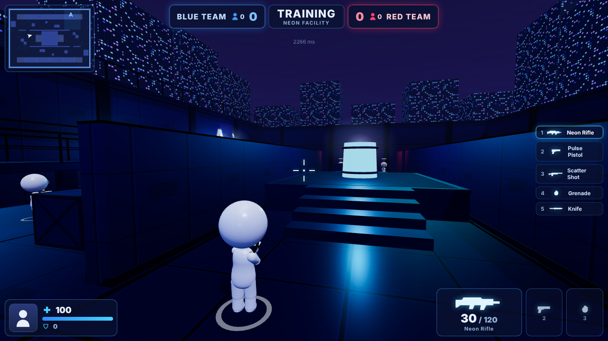

# NEON STRIKE

Third-person LAN team shooter in the browser — **Model V-773** characters in the **NEON FACILITY** arena, host-authoritative Node server, desktop + phone controls.



## Install
```bash
npm install          # only dependency: ws
npm start            # http://localhost:3000  (also prints the LAN address)
```
Node ≥ 20. No build step.

## Desktop
Open `http://localhost:3000`, type a name, then **MULTIPLAYER (LAN)** or **TRAINING**. Click the game to lock the mouse.

## LAN — host
1. Run `npm start` on the host computer (allow Node through the firewall).
2. Note the **LAN** line printed by the server, e.g. `http://192.168.1.20:3000`.
3. In the browser: MULTIPLAYER (LAN) → **CREATE ROOM**, pick BLUE/RED, wait for players, **START MATCH**.

## LAN — join (desktop or phone, same Wi-Fi)
Open the host's LAN address → MULTIPLAYER (LAN) → **JOIN ROOM** → pick a team. Players joining mid-match spawn immediately. Phones: hold the device in landscape.

## Online server (Render.com, free)
[](https://render.com/deploy?repo=https://github.com/shaxinvoy1/neonstrike)
`render.yaml` describes the service (Node 22, `npm start`, WebSocket on the same port, https → wss automatically). After deploy the game is at `https://<service>.onrender.com`; share that link or type it into the APK. Free instances sleep after ~15 min idle; the first visit wakes them (≈30–60 s). One room per server.

## Android APK (telefon)
`mobile/` — Capacitor launcher (`uz.neonstrike.game`). The APK is a **client**: the game server runs on a computer in the same Wi-Fi.
1. Computer: run `start-windows.bat` (Windows) or `./start.sh` (Linux/macOS) — needs Node.js ≥ 20. It prints `LAN : http://192.168.x.x:3000`.
2. Phone: install `NEON-STRIKE-v1.0.0.apk`, open it, type that address (e.g. `192.168.1.20:3000`), tap **ULANISH**. Recent addresses are remembered.
3. The game opens full-screen in landscape with touch controls.
Build: `cd mobile && npm install && npx cap sync android && cd android && ./gradlew assembleRelease`.

## Controls
| Action | Desktop | Phone |
|---|---|---|
| Move / sprint | WASD / Shift | left joystick (push to the top edge = sprint) / » |
| Look / aim | mouse / RMB | drag right side / AIM |
| Fire | LMB | ◉ (drag while holding to aim) |
| Reload | R | R |
| Jump / crouch | Space / C or Ctrl | ⤒ / ⤓ |
| Weapons | 1–5, Q, wheel | ⇄ |
| Grenade / knife | G / V | ● / ⟋ |
| Scoreboard / chat / pause | Tab / T or Enter / Esc | — / — / browser back |

## Rules
Two teams, 10 rounds, first to 6 round wins (5:5 = draw). A player who dies stays down until the next round. Round timer 100 s; when it expires the team with more players alive wins.

## Settings
Mouse & touch sensitivity, FOV, quality (Low/Medium/High), resolution scale, shadows, effects, volume, invert Y, FPS counter, touch controls (auto/on/off). Stored in the browser.

## Tests
```bash
npm test             # 324 unit + integration tests
npm run test:e2e     # real-browser E2E (weapons, aim, mobile, 2p, 4p, phone over LAN IP)
npm run perf         # frame / draw-call / cleanup measurement
```
Character inspection: `http://localhost:3000/viewer.html` (all animation states and weapons).

## Known limitations
No reconnection; chat is session-wide; performance was measured only on CPU software rendering (no GPU in the build environment); a physical phone was not available for testing. Details: `docs/FINAL_QA_REPORT.md`.

## Docs
`docs/PROJECT_AUDIT.md`, `IMPLEMENTATION_PLAN.md`, `ARCHITECTURE.md`, `CHARACTER_SPECIFICATION.md`, `MAP_SPECIFICATION.md`, `TEST_REPORT.md`, `PERFORMANCE_REPORT.md`, `FINAL_QA_REPORT.md`.
